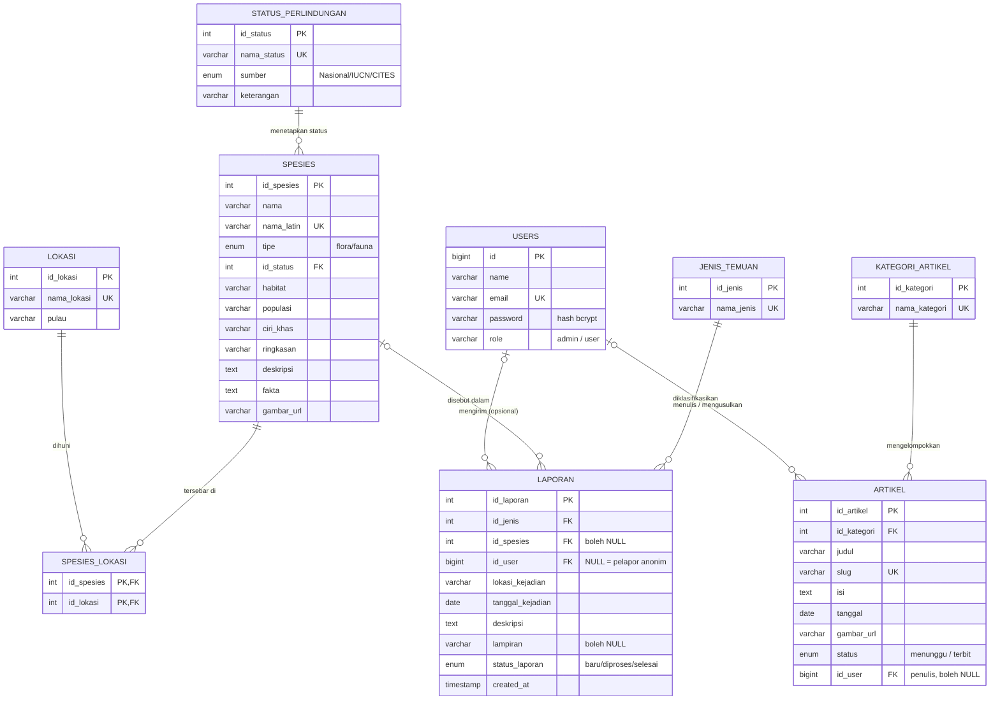

# 🌿 WildGuard

> Platform web edukasi untuk mengenal flora dan fauna yang dilindungi serta meningkatkan kesadaran masyarakat terhadap perdagangan ilegal satwa liar sebagai bentuk dukungan terhadap SDG 15.7.

---

## 👥 Anggota Kelompok

| No | Nama | NIM |
|----|------|-----|
| 1 | Kaila Audriya Setiawan | 140810250007 | 
| 2 | Farah Nadia Aqila | 140810250049 |
| 3 | Naura Alifia Lubna | 140810250088 | 


---

## Fungsi

WildGuard berfungsi sebagai platform edukasi yang membantu masyarakat untuk:

- Mengenal flora dan fauna yang dilindungi.
- Mengetahui status perlindungan suatu spesies.
- Memahami ancaman terhadap flora dan fauna.
- Meningkatkan kesadaran mengenai perdagangan ilegal satwa liar.
- Mencatat dugaan temuan perdagangan ilegal flora dan fauna.

---

## Tujuan

WildGuard dibuat untuk mendukung **Sustainable Development Goals (SDGs) Tujuan 15: Life on Land**, khususnya target **SDG 15.7**.

Tujuan WildGuard adalah meningkatkan kesadaran masyarakat mengenai pentingnya perlindungan flora dan fauna serta memberikan edukasi mengenai ancaman perdagangan ilegal terhadap keanekaragaman hayati.

### SDG 15.7

Mengambil tindakan untuk mengakhiri perburuan dan perdagangan ilegal spesies flora dan fauna yang dilindungi.

---

## Target Pengguna

WildGuard ditujukan untuk:

- Pelajar dan mahasiswa.
- Masyarakat umum.
- Pecinta lingkungan dan satwa.
- Orang yang ingin mempelajari flora dan fauna Indonesia.

---

## Mockup Kasar

###


# WildGuard – ERD & Skema Tabel (Praktikum Sistem Database)

## 1. ERD (Mermaid)

Lihat di GitHub / VS Code (ekstensi Mermaid) / https://mermaid.live



## 2. Relasi antar tabel

| Relasi | Kardinalitas | Keterangan |
|---|---|---|
| status_perlindungan → spesies | 1 : N | Satu status dipakai banyak spesies |
| spesies ↔ lokasi (via spesies_lokasi) | M : N | Satu spesies bisa di banyak lokasi, satu lokasi dihuni banyak spesies |
| kategori_artikel → artikel | 1 : N | Satu kategori punya banyak artikel |
| jenis_temuan → laporan | 1 : N | Satu jenis temuan dipakai banyak laporan |
| spesies → laporan | 1 : N (opsional) | Laporan boleh menyebut spesies yang dilihat |
| users → artikel | 1 : N (opsional) | User mengusulkan artikel (status `menunggu`), admin menyetujui jadi `terbit` |
| users → laporan | 1 : N (opsional) | Pelapor yang login memiliki laporannya; pengunjung anonim `id_user = NULL` |

Aturan hapus (ON DELETE):
- `RESTRICT` pada status, kategori, dan jenis temuan: tidak bisa dihapus selama masih dipakai.
- `CASCADE` pada `spesies_lokasi`: hapus spesies/lokasi otomatis menghapus baris penghubungnya.
- `SET NULL` pada `laporan.id_spesies`: laporan tetap ada walau spesiesnya dihapus.
- `SET NULL` pada `artikel.id_user` dan `laporan.id_user`: menghapus akun pelapor tidak menghapus laporannya.

## 3. Skema tabel

### status_perlindungan
| Kolom | Tipe | Kunci | Keterangan |
|---|---|---|---|
| id_status | INT UNSIGNED AI | PK | |
| nama_status | VARCHAR(60) | UNIQUE | mis. Dilindungi |
| sumber | ENUM(Nasional,IUCN,CITES) | | |
| keterangan | VARCHAR(255) | | NULL boleh |

### lokasi
| Kolom | Tipe | Kunci |
|---|---|---|
| id_lokasi | INT UNSIGNED AI | PK |
| nama_lokasi | VARCHAR(100) | UNIQUE |
| pulau | VARCHAR(60) | |

### spesies
| Kolom | Tipe | Kunci |
|---|---|---|
| id_spesies | INT UNSIGNED AI | PK |
| nama | VARCHAR(100) | |
| nama_latin | VARCHAR(150) | UNIQUE |
| tipe | ENUM(flora,fauna) | |
| id_status | INT UNSIGNED | FK → status_perlindungan |
| habitat | VARCHAR(150) | |
| populasi | VARCHAR(80) | |
| ciri_khas | VARCHAR(150) | |
| ringkasan | VARCHAR(255) | teks singkat di kartu |
| deskripsi | TEXT | |
| fakta | TEXT | |
| gambar_url | VARCHAR(500) | |

### spesies_lokasi
| Kolom | Tipe | Kunci |
|---|---|---|
| id_spesies | INT UNSIGNED | PK, FK → spesies |
| id_lokasi | INT UNSIGNED | PK, FK → lokasi |

### kategori_artikel
| Kolom | Tipe | Kunci |
|---|---|---|
| id_kategori | INT UNSIGNED AI | PK |
| nama_kategori | VARCHAR(60) | UNIQUE |

### artikel
| Kolom | Tipe | Kunci |
|---|---|---|
| id_artikel | INT UNSIGNED AI | PK |
| id_kategori | INT UNSIGNED | FK → kategori_artikel |
| judul | VARCHAR(200) | |
| slug | VARCHAR(220) | UNIQUE |
| isi | TEXT | |
| tanggal | DATE | |
| gambar_url | VARCHAR(500) | |

### jenis_temuan
| Kolom | Tipe | Kunci |
|---|---|---|
| id_jenis | INT UNSIGNED AI | PK |
| nama_jenis | VARCHAR(100) | UNIQUE |

### users (tabel bawaan Laravel + kolom `role`)
| Kolom | Tipe | Kunci |
|---|---|---|
| id | BIGINT UNSIGNED AI | PK |
| name | VARCHAR(255) | |
| email | VARCHAR(255) | UNIQUE |
| password | VARCHAR(255) | hash bcrypt |
| role | VARCHAR(10) | `admin` atau `user`, default `user` |

Kolom tambahan di tabel `artikel`: `status` ENUM(menunggu, terbit) default terbit, dan `id_user` BIGINT UNSIGNED NULL FK → users.

### laporan
| Kolom | Tipe | Kunci |
|---|---|---|
| id_laporan | INT UNSIGNED AI | PK |
| id_jenis | INT UNSIGNED | FK → jenis_temuan |
| id_spesies | INT UNSIGNED NULL | FK → spesies |
| id_user | BIGINT UNSIGNED NULL | FK → users (NULL = pelapor tanpa akun) |
| lokasi_kejadian | VARCHAR(200) | |
| tanggal_kejadian | DATE | |
| deskripsi | TEXT | |
| lampiran | VARCHAR(255) NULL | path foto/PDF pendukung |
| status_laporan | ENUM(baru,diproses,selesai) | default baru |
| created_at | TIMESTAMP | default now |

Normalisasi: semua tabel sudah 3NF. Status dan lokasi dipisah dari spesies agar tidak ada pengulangan teks, dan relasi M:N dipecah lewat tabel penghubung.

## 4. Catatan untuk presentasi

**Manfaat aplikasi**
- Data spesies dilindungi tersimpan terpusat dan bisa diperbarui admin tanpa mengubah kode.
- Masyarakat bisa melapor dugaan perdagangan ilegal, dan laporan terlacak statusnya (baru → diproses → selesai).
- Relasi antar tabel membuat informasi konsisten (satu status dipakai banyak spesies, laporan terhubung ke spesies).
- Mendukung SDG 15.7.

**Hak akses (login)**
| Peran | Baca situs | Kirim laporan | Laporan Saya | Tambah/Ubah/Hapus data | Panel /admin |
|---|---|---|---|---|---|
| Pengunjung (tanpa login) | ✔ | ✔ (anonim) | ✘ | ✘ | ✘ |
| User (pelapor terdaftar) | ✔ | ✔ (tercatat atas akunnya) | ✔ (laporan sendiri) | hanya laporan dan usulan artikel sendiri | ✘ |
| Admin | ✔ | ✔ | ✔ | ✔ (tombol langsung di situs + panel) | ✔ |

**Peta CRUD**
| Menu | Create | Read | Update | Delete |
|---|---|---|---|---|
| Spesies (+ lokasi M:N) | ✔ | ✔ (cari, filter, detail) | ✔ | ✔ |
| Artikel (admin) | ✔ | ✔ | ✔ | ✔ (+ setujui usulan) |
| Artikel Saya (usulan user) | ✔ (status menunggu) | ✔ | ✔ (selama menunggu) | ✔ (selama menunggu) |
| Laporan (admin) | ✔ | ✔ | ✔ (ubah status) | ✔ |
| Laporan Saya (pelapor login) | ✔ (form di beranda) | ✔ | ✔ (selama status baru) | ✔ (selama status baru) |
| Pengguna | ✔ | ✔ | ✔ (termasuk peran) | ✔ |
| Status, Lokasi, Kategori, Jenis Temuan | ✔ | ✔ | ✔ | ✔ |

**Ide pengembangan**
- Verifikasi email dan reset password.
- Peta sebaran laporan, statistik per wilayah.
- Notifikasi ke BKSDA saat laporan baru masuk.
- API untuk aplikasi mobile.

**Contoh query untuk demo (JOIN / agregat)**
```sql
-- Spesies beserta statusnya
SELECT s.nama, s.tipe, p.nama_status
FROM spesies s JOIN status_perlindungan p ON p.id_status = s.id_status;

-- Lokasi tiap spesies (M:N)
SELECT s.nama, GROUP_CONCAT(l.nama_lokasi SEPARATOR ', ') AS lokasi
FROM spesies s
JOIN spesies_lokasi sl ON sl.id_spesies = s.id_spesies
JOIN lokasi l ON l.id_lokasi = sl.id_lokasi
GROUP BY s.id_spesies;

-- Jumlah laporan per jenis temuan
SELECT j.nama_jenis, COUNT(*) AS total
FROM laporan l JOIN jenis_temuan j ON j.id_jenis = l.id_jenis
GROUP BY j.id_jenis;
```
